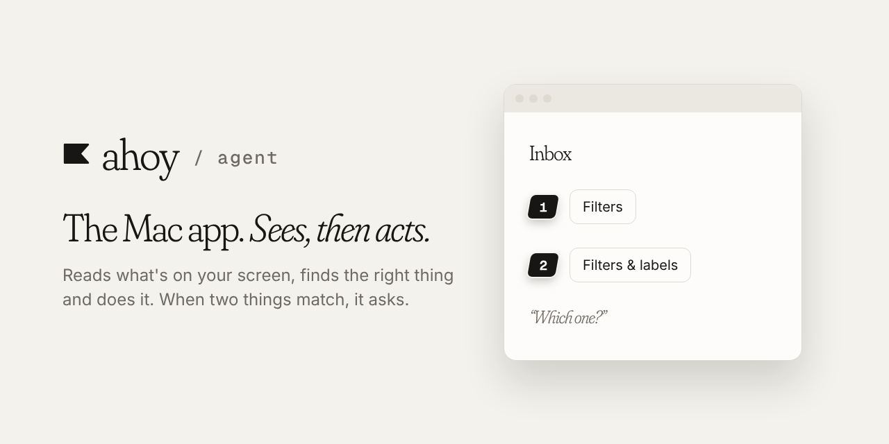

**Ahoy** is a voice assistant that lets you control your Mac from your phone. This repo is the Mac app that does the work.

[▶ Watch the 1:45 demo](https://drive.google.com/file/d/1JMgSd2bm7LtUCs2WxiTNWuo0-bijqs4p/view?usp=sharing) · [All Ahoy repos](https://github.com/getahoy)

# Ahoy for Mac

The Mac side of Ahoy. It waits for your phone on your Wi-Fi, reads what's on your screen, and does what you said: it opens apps, clicks buttons, types and presses shortcuts.

## How it works

| Piece | Job |
|---|---|
| **Electron app** (`src/`) | The menu bar icon, the popover, the main window and the setup flow. It pairs with your phone, receives your commands and decides what to do. |
| **Swift helper** (`native/macos-helper`) | A small native program that reads the screen through macOS Accessibility and does the clicking and typing. It decides nothing: it answers "what's on screen?" and obeys "click this". |

When you speak:

1. Your phone sends the command over an end-to-end encrypted connection (Noise protocol) on your local network.
2. The app asks the helper what's on screen, and matches your words to it.
3. One clear match: it acts and tells your phone what it did.
4. Two or more matches: numbered tags appear on your screen and your phone asks "Which one?".
5. Anything destructive, like deleting or sending, waits for a tap on your phone.

## Setup

Needs macOS, Node with pnpm, and Xcode (for the Swift helper).

```bash
# build the shared packages first
cd ../shared && pnpm install && pnpm build && cd ../agent

pnpm install
cp .env.example .env    # VITE_AHOY_API_URL points at the web server
pnpm start              # builds the Swift helper, then opens the app
```

On first launch, macOS asks for **Accessibility** and **Screen Recording** permission. Grant both in System Settings, restart Ahoy, then scan the QR code with the Ahoy iPhone app.

## Scripts

| Script | Does |
|---|---|
| `pnpm start` | Builds the helper and runs the app |
| `pnpm helper` | Builds the helper and opens a console to talk to it directly |
| `pnpm make` | Builds the `.dmg` and `.zip` |
| `pnpm test` | Unit tests for the core logic |
| `pnpm typecheck` | `tsc` |
| `pnpm lint` | Biome checks |
